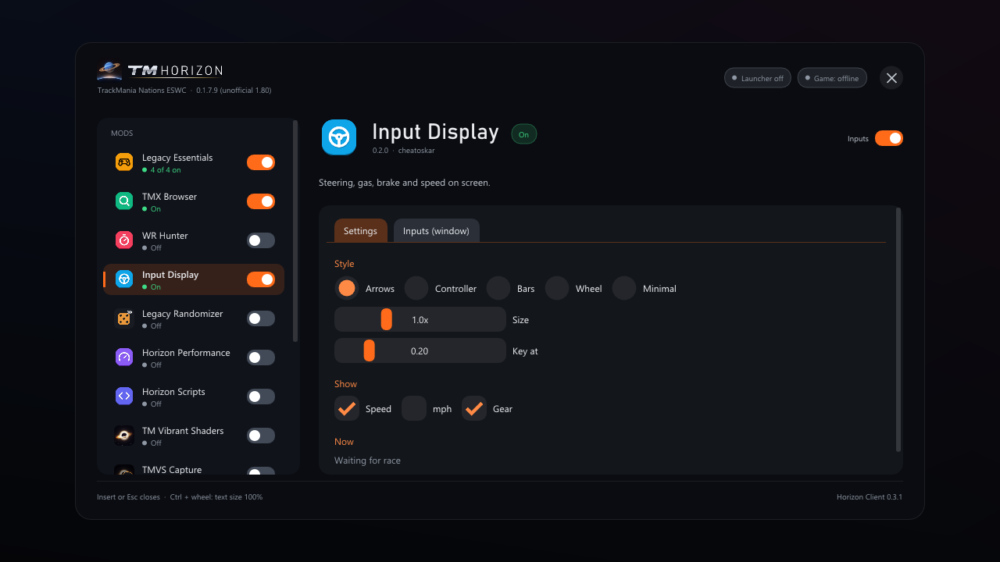
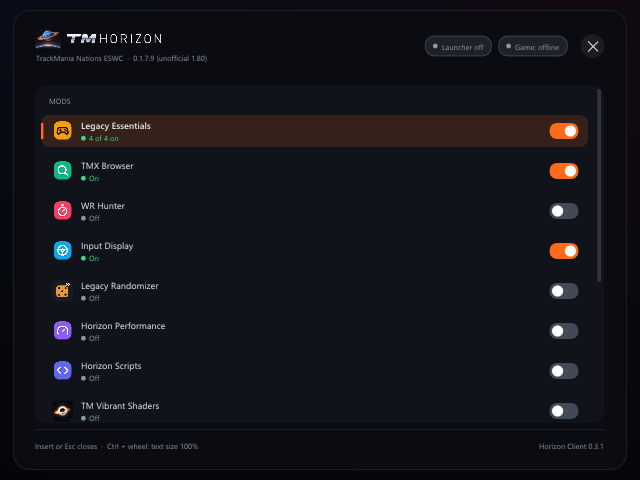
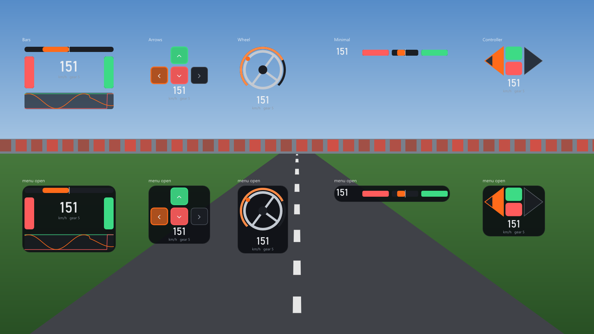

# Horizon Client

**An in-game menu and mod loader for the old TrackMania games: TrackMania Nations ESWC, TrackMania Sunrise, TrackMania Original and, through TMLoader, TrackMania Nations/United Forever (experimental).**

One menu for all modules, a slim bar at the top screen edge, widgets you can move, hotkeys with conflict display, one log per start, and a small C plugin ABI so mods stop fighting over Direct3D and game hooks. It is the in-game part of the [TM Horizon](https://github.com/cheatoskar/tm-horizon) launcher, but it works on its own.

Version 0.3.1. MIT licence. Built with [Claude Code](https://claude.com/claude-code).

**[Download the latest release](https://github.com/cheatoskar/horizon-client/releases/latest)** · [Install](#install) · [Modules](#modules) · [Games](#features-per-game) · [Controls](#controls) · [Safety rules](#safety-rules) · [Compatibility](#compatibility) · [Known issues](#known-issues) · [Build](#how-it-is-built) · [TM Horizon family](#tm-horizon-family)



*The menu on a new TrackMania Nations ESWC install, Input Display open. Preview render with the real module list, no game running.*



*In a small window (here 640x480) the menu shrinks and shows the list or the page.*



*Input Display: Bars, Arrows, Wheel, Minimal and Controller, on screen in a race (top) and with the menu open (bottom). Preview render on a stand-in picture, not a game capture.*

---

## TM Horizon family

Six projects, built to work together. TM Horizon installs and updates the others where it can; each one also works without it.

| Project | What it is | Games | How to get it | Repo |
|---|---|---|---|---|
| **TM Horizon** | Launcher for every TrackMania game on Windows: library, mods, maps, servers, statistics. Installs and updates Horizon Client, Legacy Essentials and TM Vibrant Shaders. | All, from TrackMania (2003) to Trackmania (2020) | Installer from the releases (0.5.1, Launcher Preview) | [cheatoskar/tm-horizon](https://github.com/cheatoskar/tm-horizon) |
| **Horizon Client** (this repo) | In-game menu and mod loader with modules: Legacy Essentials, TMX Browser, TMX Upload, WR Hunter, Input Display, Horizon Performance, Horizon Scripts. | ESWC, Sunrise, Original; TMNF and TMUF through TMLoader (experimental) | TM Horizon (game page), or a zip per game (0.3.1) | [cheatoskar/horizon-client](https://github.com/cheatoskar/horizon-client) |
| **Legacy Essentials** | Autosave, controller fix, login fix and game settings. A standalone `dinput8.dll` mod with its own menu (`Ctrl+F2`). The same features are the "Legacy Essentials" group in Horizon Client. | ESWC, Sunrise, Original | A zip per game (1.3.1); TM Horizon installs it on ESWC | [cheatoskar/eswc-autosave](https://github.com/cheatoskar/eswc-autosave) |
| **Legacy Randomizer** | Random Map Challenge with maps from TMX, inside the game. A Horizon Client module. | ESWC, Sunrise, Original (solo) | A zip with Horizon Client, or the plugin alone (0.3.1) | [cheatoskar/legacy-randomizer](https://github.com/cheatoskar/legacy-randomizer) |
| **TM Vibrant Shaders** | Lighting, weather, skies, photos, clips and video export. Standalone, or as four Horizon Client modules. | TMNF, TMUF, TM2; ESWC, Sunrise, Original experimental | Setup or ModLoader server (1.6.0), Horizon modules zip (2.0.0); TM Horizon installs it on TMNF, TMUF and ESWC | [cheatoskar/TM-Vibrant-Shaders](https://github.com/cheatoskar/TM-Vibrant-Shaders) |
| ***For developers*** | | | | |
| **trackmania-internals** | Notes for mod developers: addresses, structures, file formats and physics of the games. | TMNF, TMUF, ESWC, Sunrise, Original, ManiaPlanet | Read it on GitHub | [cheatoskar/trackmania-internals](https://github.com/cheatoskar/trackmania-internals) |

TMNF/TMUF = TrackMania Nations/United Forever, ESWC = TrackMania Nations ESWC, TM2 = TrackMania 2 (ManiaPlanet).

- **Legacy Essentials or Horizon Client:** one is enough. Horizon Client has the same features in its "Legacy Essentials" group. With both in one game, the standalone keeps the autosave (the client's Autosave module pauses itself and logs `standalone ESWC Autosave found (eswc_autosave.dll): module paused`), and the login fix, controller fix, game settings and menu are the client's.
- **TM Vibrant Shaders standalone or as Horizon modules:** one of the two. With both installed, the one the game loads first runs and the other stays off.

---

## Supported exes

Only these exes. Any other exe: the host stays off and writes why into its log. No StarForce versions.

| Game | Exe | SHA-256 | Loaded by |
|---|---|---|---|
| TrackMania Nations ESWC | `TmNationsESWC.exe`, unofficial 1.80 (0.1.7.9) | `983bd12724739dcb0f876aeb3a4259154b068940f5167f57ede750ca452d8068` | Legacy Loader |
| TrackMania Sunrise | `TmSunrise.exe`, Win10 community repack | `e59dfc7eaa5314e85b2b0df6f40ef7ba01a23bd5a9525f84407f5dff301df4fe` | Legacy Loader (works through the repack's own `d3d9.dll`) |
| TrackMania Original | `TMORIGINAL.EXE` of the community Online Patch v2 (2023) | `75e129d769f4595ddde54a8ef484162915bc2bf998c1a2139cc963294fe8175e` | Legacy Loader (works through the patch's dgVoodoo `d3d9.dll`) |
| TrackMania Nations Forever | `TmForever.exe` 2.11.26 | `3847cf9f20bfc63914450060ed528c12104f743d96ad23d6e76abd178de8c84f` | TMLoader product |
| TrackMania United Forever | `TmForever.exe` 2.11.26 | `4b6a7b31d86766409e94101f1256cd61dffecb23ea497a40b6617506b2ced2d4` | TMLoader product |
| TrackMania Forever (TMLoader) | TMLoader 2.12.0 | `8c5325d04a10d5e6921afb9931770279cca8cdfc7f66425b6365d0a870f5694a` | TMLoader product |
| TrackMania Forever (TMLoader) | TMLoader 2.12.0-compat | `0a885e194131063be9f78d9e5cf81e0f3017dfc4331d176812109b6aefc633bf` | TMLoader product |

The table lives in [`src/host/exe_known.h`](src/host/exe_known.h) (with PE timestamp and file size where they are checked).

---

## Install

**With TM Horizon (easiest):** open the game's page in the [TM Horizon](https://github.com/cheatoskar/tm-horizon) launcher and switch Horizon Client on. It downloads the release and checks every file against `manifest.json`. On Nations/United Forever it needs TM Horizon 0.5.1 and goes into the TMLoader profiles you pick. Modules are switched on the game page and on TM Horizon's Mods page ("Horizon modules").

**By hand, ESWC, Sunrise, Original:** download `Horizon-Client-<version>-<game>.zip` from the [releases](https://github.com/cheatoskar/horizon-client/releases/latest), unzip it into the game folder (next to the exe) and double-click `Horizon-Install.cmd`. It copies the Legacy Loader `dinput8.dll` next to the exe. If another mod already has a `dinput8.dll` there, that file becomes `dinput8.chain.dll` and keeps working: the loader runs it first.

**By hand, TMNF/TMUF (experimental):** download `Horizon-Client-<version>-TMLoader.zip` and put its `Horizon Host` folder into `%LOCALAPPDATA%\TMLoader\database\TmForever\products\`, then tick "Horizon Client" in your TMLoader profile.

Then start the game and press **Insert**. A new install starts with Legacy Essentials (legacy games) and TMX Browser on; TMX Upload switches on once the game is paired with TM Horizon. Everything else is one click in the menu.

| File in the release | For |
|---|---|
| `Horizon-Client-<version>-ESWC.zip` | TrackMania Nations ESWC |
| `Horizon-Client-<version>-Sunrise.zip` | TrackMania Sunrise |
| `Horizon-Client-<version>-Original.zip` | TrackMania Original |
| `Horizon-Client-<version>-TMLoader.zip` | Nations/United Forever through TMLoader |
| `manifest.json` | file list with SHA-256, read by TM Horizon |
| `SHA256SUMS.txt` | checksums of the zips |

**Uninstall:** ESWC, Sunrise, Original: double-click `Horizon-Uninstall.cmd` (removes Horizon's `dinput8.dll`, gives `dinput8.chain.dll` its old name back), then delete the `horizon` folder. TMLoader: untick it or delete the `Horizon Host` product folder.

---

## Modules

A module is a plugin DLL with its own page in the menu, its own switch and its keys in the *Hotkeys* list. Switching a module on or off takes effect at once.

| Module | What it does | Games | On at first start |
|---|---|---|---|
| **Legacy Essentials** (group) | One entry with one switch for the four parts below, a switch per part on its page, and each part's own page as a tab. Same name and features as the standalone [Legacy Essentials](https://github.com/cheatoskar/eswc-autosave). Not shown on TMNF/TMUF. | ESWC, Sunrise, Original | yes |
| ↳ Autosave | Saves the replay after each finish with the game's own save code, into `My Replays` as `<map>(mm'ss''cc).Replay.Gbx`. ESWC: solo and online (your previous run), plus a TMX copy of online replays with only your ghost. Sunrise, Original: solo only. "Every finish" or new bests only. `F9` saves now. [docs](docs/plugins/eswc-autosave.md) | ESWC, Sunrise, Original | yes |
| ↳ Controller fix | A controller plugged in or switched on while the game runs is added at once, with the game's own bindings. [docs](docs/plugins/controller-hotplug.md) | ESWC, Sunrise, Original | yes |
| ↳ Login fix | The online login works again on Windows 10/11 (error 12157): TLS 1.0 and no revocation check, for the game process only. Applies on the next start. | ESWC, Original | yes |
| ↳ Game settings | Volume, music and window mode of the game from the menu, applied at every start. Window mode switches at once. | ESWC, Sunrise, Original | yes |
| **TMX Browser** | Search TrackMania Exchange from the game, pictures, favourites, Save, and Play: the map starts in the game (main menu, offline; on ESWC, Sunrise and Original also during a solo race). Works without TM Horizon. [docs](docs/plugins/tmx-browser.md) | all five | yes |
| **TMX Upload** | Offers the replays you drive to an uploader on the same PC (TM Horizon or the browser extension of the 100% TMX mod), after you press Allow in the game. Sends nothing on its own. [docs](docs/plugins/tmx-upload.md) | all five | once paired with TM Horizon |
| **WR Hunter** | Splits at every checkpoint against your PB and a target (TMX record, race ghost or a replay file), gold sectors, sum of best, history per map. Checkpoints blue (faster) and red (slower). [docs](docs/plugins/wr-hunter.md) | all five | no |
| **Input Display** | Steering, gas, brake, speed, gear and RPM on screen, in five styles: Bars, Arrows, Wheel, Minimal, Controller. [docs](docs/plugins/input-display.md) | all five | no |
| **Horizon Performance** | Frame times (game, Present, limiter), Direct3D 9 call counts, benchmark (`Ctrl+Shift+B`), frame limiter, hang log. Presets Smooth, Low latency, Custom. [docs](docs/performance.md) | all five | no |
| **Horizon Scripts** | Runs AngelScript scripts from `horizon\scripts` with a read-only API. Comes with two widgets, Clock and Map Info. [docs](docs/scripting.md) | all five | no |

The Legacy Randomizer ([cheatoskar/legacy-randomizer](https://github.com/cheatoskar/legacy-randomizer)) and the TM Vibrant Shaders modules ([docs](https://github.com/cheatoskar/TM-Vibrant-Shaders/blob/main/docs/horizon-modules.md)) are separate plugins with their own releases. They go into `horizon\plugins\` (TMLoader: `Horizon Host\<version>\plugins\`) and show up in the same menu. Node Explorer, a read-only browser for the game's classes and objects, is a developer tool and not in the release zips.

### The menu

- **Bar** at the top screen edge: module icons (left click opens the module in its own window, right click opens its page in the menu), Menu, Layout, Log and TM Horizon buttons. In a small window the buttons shrink to icons.
- **Widgets**: module panels on screen (Input Display, WR Hunter splits, script widgets). *Edit layout* (`Ctrl+Insert`, the Layout button or General): move, resize, minimise to an edge icon, hide, Reset. Places are saved with an anchor, so a widget at the top right stays there at any resolution. A switch next to a module's title shows or hides its widgets.
- **General**: menu size (Auto or 60-90 %), text and icon size (80-125 %, also `Ctrl` + mouse wheel), icon set (Distinct or Saturn), menu background (opacity 50-100 %), toasts ("Do not disturb", "Quiet while driving"), TM Horizon pairing and "Forget pairing", Shared setup.
- **Shared setup**: one setup for every game install of your Windows user (`%APPDATA%\Horizon Client\shared\`), with "Copy from this game", "Reset", "Export" and "Import". [docs](docs/shared-setup.md)
- **Toasts**: short notes in a corner (a saved replay, a module error, TM Horizon's notifications), hidden in photos and videos.
- **Crash guard**: a module that throws while drawing is switched off alone; the menu and the other modules keep working.

---

## Features per game

✓ = works, experimental = in the release but parts not run in a game yet, – = not available.

| | ESWC | Sunrise | Original | TMNF / TMUF (TMLoader) |
|---|---|---|---|---|
| Menu, bar, hotkeys, log, layout mode | ✓ | ✓ | ✓ | experimental (input only in the game's menus) |
| Game events | map, start, checkpoint, respawn, finish, race end, state | map, start, checkpoint, finish, solo race end, state | as Sunrise | map, start, finish, state, by reading only (no hooks) |
| Login fix (error 12157) | ✓ | – (not known to be needed) | experimental (not tested against the server yet) | – |
| Autosave | ✓ solo and online, TMX copy | experimental, solo | experimental, solo | – |
| Controller fix | ✓ | experimental | experimental | – |
| Game settings | ✓ | experimental | experimental | – |
| TMX Browser, TMX Upload, WR Hunter, Input Display | ✓ | ✓ | experimental | experimental |
| TMX Browser: Play in the game (no TM Horizon needed) | ✓ (main menu, solo race) | ✓ (main menu, solo race) | ✓ (main menu, solo race) | experimental, through the game's own TMX link (main menu) |
| Horizon Performance, Horizon Scripts (with widgets) | ✓ | ✓ | ✓ | experimental |
| TM Horizon opens a map in the running game | ✓ (main menu) | ✓ (main menu) | ✓ (main menu) | – |
| Legacy Randomizer (separate plugin) | ✓ | ✓ (needs 0.3.1) | experimental | – |
| TM Vibrant Shaders modules (separate plugins) | ✓ | ✓ (not tested in the game yet) | ✓ (not tested in the game yet) | ✓ |

Sunrise and Original are found statically (addresses checked against the exes); parts of them have not run in a game yet, see [CHANGELOG.md](CHANGELOG.md). TrackMania Sunrise has no online servers any more, so everything there is solo or LAN.

---

## Controls

| Key | Action |
|---|---|
| `Insert` | Open or close the menu (changeable in the menu) |
| `Esc` | Close the menu |
| `Ctrl+Insert` | Edit layout: move and resize widgets |
| `Ctrl+F4` | Show script widgets (Horizon Scripts) |
| `F9` | Save replay now (Autosave) |
| `Ctrl+Shift+B` | Benchmark start/stop (Horizon Performance) |
| `Shift` held while the game starts | Safe mode: the host starts, no modules |
| `Ctrl+Shift` held while the game starts | No Horizon: DirectInput only |

Every module key is in the menu's *Hotkeys* list and can be changed there. Keys of other mods the host knows (TM Vibrant Shaders, TM Clips, the old ESWC Autosave) are shown as conflicts. While the menu is open the game gets no keyboard or mouse input; when it closes, every key you still held is released in the game.

Files: settings in `horizon\settings\`, a log per start in `horizon\logs\` (TMLoader: next to the version folders in `Horizon Host\`).

---

## Safety rules

- **Forever is read-only.** No game hooks, no memory writes; game events come from reading the game's objects once a frame. The only input change: while the menu (or a text field) has the keyboard, the game's DirectInput keyboard gets no key presses, so Enter or Backspace typed into the menu do not respawn the car; with Competition Patch loaded not even that. With Competition Patch loaded, game control and reflection writes stay off during a run.
- **No validation changes.** No module touches timing, physics, inputs or the replay of a run. Autosave saves after the run with the game's own save code.
- **TMX rules** for every module, online or not: no checkpoint or trigger display, no ideal or brake line, no disabling of camera or MediaTracker behaviour.
- **Online gate.** Modules marked `solo-only` stop while the game is online; game control (start a map) works only from the main menu (on ESWC, Sunrise and Original also from a solo race) and never online.
- **No StarForce.** Only the exes in the table above; anything else and the host stays off.

Details: [docs/plugin-abi.md](docs/plugin-abi.md), "Online gate" and "Competition Patch".

---

## Compatibility

| Together with | |
|---|---|
| [Legacy Essentials](https://github.com/cheatoskar/eswc-autosave) (standalone, formerly ESWC Autosave) | Not needed: the "Legacy Essentials" group has the same features. With both: the standalone keeps the autosave, the client's Autosave module pauses itself (`standalone ESWC Autosave found (eswc_autosave.dll): module paused`), the rest is the client's. The install script keeps the standalone's `dinput8.dll` as `dinput8.chain.dll`. |
| [TM Vibrant Shaders](https://github.com/cheatoskar/TM-Vibrant-Shaders) | Standalone or as Horizon modules, not both: with both, the one the game loads first runs. The host hooks Direct3D 9 through method tables only and runs next to it. |
| Another mod's `dinput8.dll` | Kept as `dinput8.chain.dll` and loaded first. |
| The game's own `d3d9.dll` (Sunrise repack, dgVoodoo in Original) | Works through it. |
| kiero / MinHook mods | Works next to them (method-table hooks only). |
| Competition Patch (TMNF/TMUF) | Game control and reflection writes stay off during a run. |
| TMLoader | 2.12.0 and 2.12.0-compat. |

---

## Known issues

- **Sunrise and Original:** addresses are checked against the exes, but parts (Autosave, Controller fix, Game settings, the login fix on Original, leaving a race) have not run in a real game yet. Tell me what happens, with the log from `horizon\logs\`.
- **Nations/United Forever** is experimental: the layout mode and the menu's mouse work only in the game's menus, not while driving.
- **Windows Defender** flags `TMLoader.exe` itself as a potentially unwanted app since 2026-11-12, so Forever may not start through TMLoader until you allow it in Windows Security > Protection history. This is TMLoader, not Horizon Client.
- **TrackMania Sunrise** has no online servers any more.
- Report bugs in the [issues](https://github.com/cheatoskar/horizon-client/issues) with the log of that start.

---

## How it is built

| Piece | File | What it does |
|---|---|---|
| Legacy Loader | `dinput8.dll` (next to the exe, a few KB, no C runtime) | Passes DirectInput through (to `dinput8.chain.dll` if there is one, else to the system DLL) and loads `horizon\host.dll`. Shift = safe mode, Ctrl+Shift = no host. Nothing else. |
| Host | `horizon\host.dll` (TMLoader: `Horizon Host\<version>\HorizonHost.dll`) | Direct3D 9 hook through method tables only (CreateDevice, Present, Reset; coexists with TM Vibrant Shaders and kiero/MinHook mods), Dear ImGui menu and bar, hotkeys, settings, per-start log, plugin loading, game events, online gate. |
| Modules | `horizon\plugins\<id>\` (`<id>.dll` + `plugin.json`) | Native DLLs against [`include/horizon_plugin.h`](include/horizon_plugin.h). |

Build needs the MSVC Build Tools (x86 toolset) and Python 3:

```
build.cmd              everything into dist\legacy\, tests into build\test\
build.cmd package      the same, then the release zips (dist\release\) and dist\manifest.json
tests\run_tests.cmd    every test without a game
tests\run_perf_tests.cmd
```

## Docs

- [docs/plugin-abi.md](docs/plugin-abi.md): writing a module
- [docs/modules-json.md](docs/modules-json.md): module groups and first-start defaults
- [docs/scripting.md](docs/scripting.md): scripts for Horizon Scripts (AngelScript)
- [docs/shared-setup.md](docs/shared-setup.md): one setup for every game (shared setup, export/import, widget anchors)
- [docs/profile-json.md](docs/profile-json.md): how TM Horizon switches modules on
- [docs/client-bridge.md](docs/client-bridge.md): the local protocol between the game and TM Horizon
- [docs/performance.md](docs/performance.md): Horizon Performance and the benchmark
- [docs/plugins/](docs/plugins/): one page per module
- [docs/roadmap.md](docs/roadmap.md): what comes next
- [CHANGELOG.md](CHANGELOG.md), [TESTPLAN.md](TESTPLAN.md) (my test steps, German)
- Game internals behind the modules: [trackmania-internals](https://github.com/cheatoskar/trackmania-internals)

## Credits

- [Dear ImGui](https://github.com/ocornut/imgui) 1.91.5 (MIT), [AngelScript](https://www.angelcode.com/angelscript/) 2.38.0 (zlib, Horizon Scripts only), [Lucide](https://lucide.dev) icons (ISC), [stb_image](https://github.com/nothings/stb) (MIT/public domain), and the reflection and game-control modules from my [legacy-randomizer](https://github.com/cheatoskar/legacy-randomizer) repo (MIT); see [third_party/README.md](third_party/README.md).
- TMX Browser and WR Hunter use the [TrackMania Exchange](https://tm-exchange.com) API. TMX Upload speaks the bridge protocol of the 100% TMX mod.
- TrackMania is a trademark of Ubisoft/Nadeo. This project is not affiliated with them and ships no game files.

## Licence

MIT ([LICENSE](LICENSE)).
